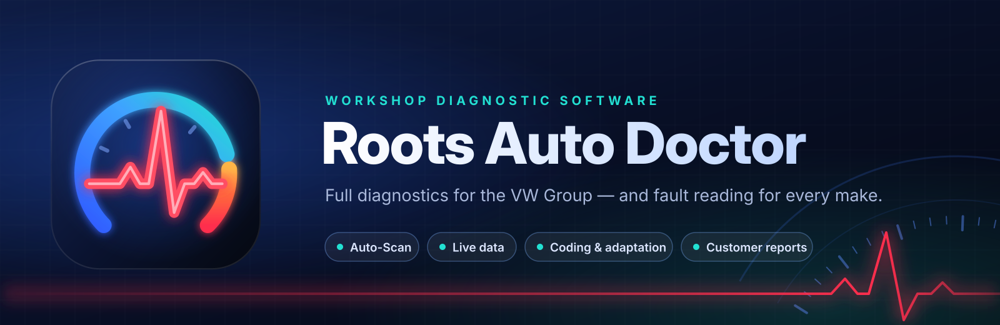
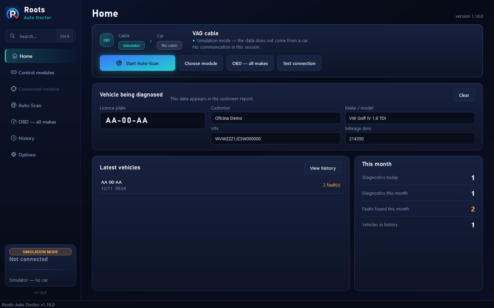
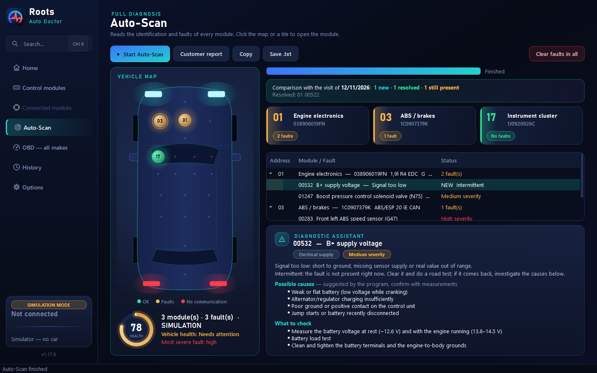
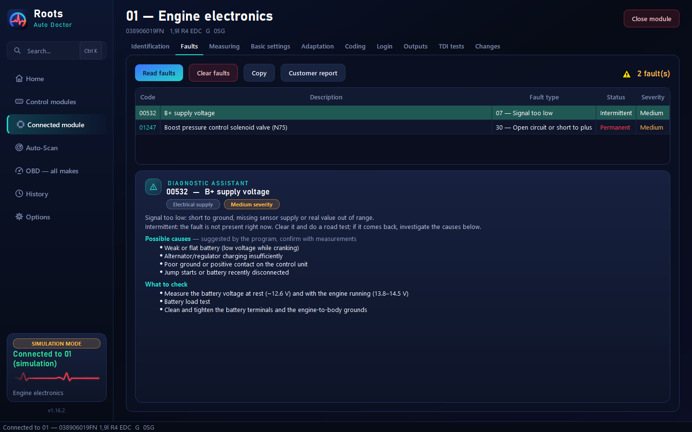
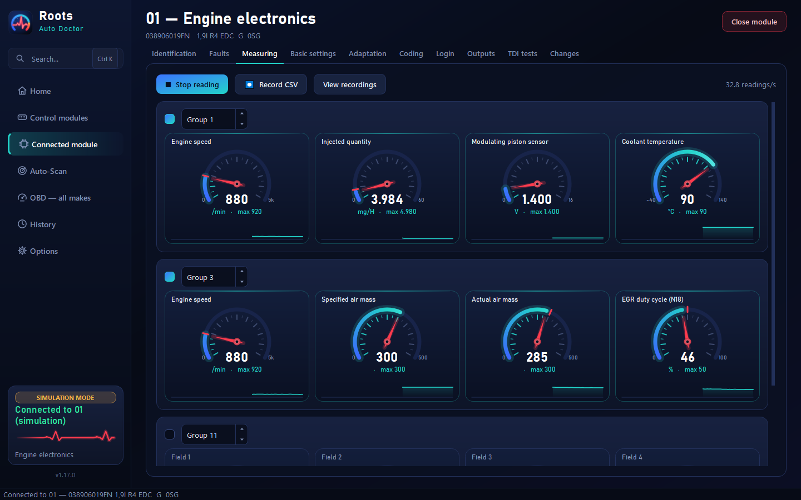
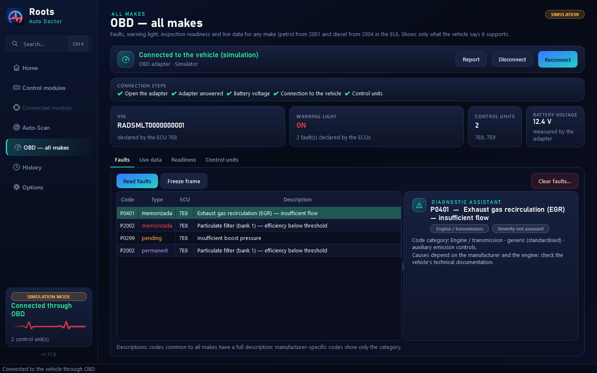

  

  <b>English</b> · <a href="README.pt.md">Português</a>

  
  
  
  

  <b>Diagnostic software for workshops.</b> 
  Full diagnostics for the VW Group, and fault reading for any make — in one application.

  

---

## What it does

### 🔍 Diagnosis
- **Auto-Scan with a vehicle map** — reads every module and shows on the car where the faults are, with a vehicle
  health score and one-click fault clearing
- **Diagnostic assistant** — severity, probable causes and what to check for each fault
- **Visit comparison** — new, resolved and recurring faults since the car's last visit
- **Live data** on gauges and charts, with recording to a spreadsheet file
- **Guided tests** for 1.9 TDI engines: injector balance, boost pressure and air mass
- **Any make** — faults, warning light, inspection readiness and live data through a standard OBD adapter

### 🔧 Workshop functions
- **Basic settings, adaptation, coding, login, output tests and service reset**
- **Change history** — every coding and adaptation is saved with its previous value, so the original can be
  restored in two clicks
- **Nothing is reported as done until the module confirms it** — every saved value is read back

### 📄 Customers and reports
- **Reports in two versions** — a plain one for the customer and a technical one for the workshop, with your logo,
  the faults found, probable causes and the work done; preview, save to PDF or print
- **Vehicles and customers** — every car is registered once; type a plate or read the VIN and the customer's
  details fill in by themselves
- **Diagnostic history** searchable by number plate, VIN or customer

### 💻 The program
- **Built-in simulator** to try every function without a car
- **Large display mode** to read the screen from inside the car
- **Portuguese and English**
- **Works offline**, with **automatic updates** when there is a connection

## Screenshots

  

| Auto-Scan with vehicle map | Fault codes with diagnostic assistant |
|---|---|
|  |  |
| **Live data on gauges** | **Any make (OBD)** |
|  |  |

Screens taken with the built-in simulator.

## Vehicles

| | |
|---|---|
| **VW, Audi, Seat, Škoda up to ~2005** | Full diagnostics, including coding and adaptation — e.g. Golf IV, Bora, Passat B5, Audi A3 8L, A4 B5/B6, Seat Leon 1M, Škoda Octavia I |
| **VW, Audi, Seat, Škoda from ~2004** *(beta)* | Identification, fault codes and measuring values of every module, Auto-Scan — e.g. Golf V/VI, Audi A3 8P, Passat B6, Octavia II |
| **Any make** | Fault codes, warning light, readiness and live data on cars with OBD diagnostics (petrol from 2001, diesel from 2004 in the EU) |

## Cables and interfaces

| Equipment | For | Status |
|---|---|---|
| **VAG diagnostic cable (KKL)**, USB | VW Group up to ~2005 | ✅ Ready · 🚗 on-car validation in progress |
| **OBD adapter** (USB or Bluetooth; OBDLink recommended) | Any make · VW Group from ~2004 | ✅ Ready · 🚗 on-car validation pending |
| **Professional diagnostic interface** (J2534 PassThru) | VW Group · any make | ✅ Ready · 🚗 on-car validation pending |
| Closed interfaces of other diagnostic systems | — | ⛔ Not supported — the program recognises them and explains why |

"Ready" means every function works and is tested with the built-in simulator; fault reading was also checked
against real data captured from a car. The full, per-protocol status is in [docs/COVERAGE.md](docs/COVERAGE.md).

## What you need

- A PC with **Windows 10 or Windows 11 (64-bit)**
- One of the cables or interfaces above

**Nothing else to install.** Roots Auto Doctor brings everything it needs.

## Download

Get it from the [Releases](https://github.com/rNx1337k/RootsAutoDoctor/releases) page:

- **`Setup_RootsAutoDoctor_<version>.exe`** — installs the program with Start menu and desktop shortcuts
  (recommended)
- **`RootsAutoDoctor_<version>_portatil.zip`** — portable version: extract it anywhere (even a USB stick) and
  open `RootsAutoDoctor.exe`

> [!NOTE]
> The first time, Windows may show *"Windows protected your PC"*: click **More info → Run anyway**.

## Getting started

1. Plug the cable into the PC and open Roots Auto Doctor.
2. Go to **Options → Detect cable** — the program finds the cable by itself.
3. Plug the cable into the car, switch the ignition on and click **Test connection**.
4. Run an **Auto-Scan**, or pick a module.

No car nearby? Click **Open simulator** on the home screen.

## Licence

Each licence is for one workshop PC and is activated **offline**: send the PC ID shown in **Options → Licence**
to your supplier and paste the key you receive. Without a licence the program works in demo mode — it reads
everything but does not change anything on a real car.

## Support

Something not working on a car? Go to **Options → Record communication**, repeat what failed, stop the recording
and send the **Support package** to your supplier. It contains the program's logs and the latest recordings — no
customer data.

Diagnostics, settings, the licence and the workshop logo are kept on the PC and are not removed when the program
is uninstalled or updated.

## Updates

Roots Auto Doctor keeps itself up to date, installed or portable, with nothing to click: it looks for a new
version when it opens and every few hours, and downloads it in the background. If you have not started working
yet, it closes, updates and opens again by itself; otherwise it installs when you close the program (or straight
away with **Update to version …**). Only versions signed by the publisher are installed. If an update does not
finish, the program keeps working on the previous version and tells you.

## Status

Roots Auto Doctor is in **beta**. Every function can be tried with the built-in simulator, and on-vehicle
validation is in progress. Simulated results are always labelled as such, on screen and in reports.

---

Copyright © 2026. All rights reserved. This software is proprietary and may not be copied, modified or
redistributed without written permission. VW, Audi, Seat and Škoda are trademarks of their respective owners;
Roots Auto Doctor is an independent product and is not affiliated with Volkswagen AG.
Developer documentation: [docs/DEVELOPMENT.md](docs/DEVELOPMENT.md).
