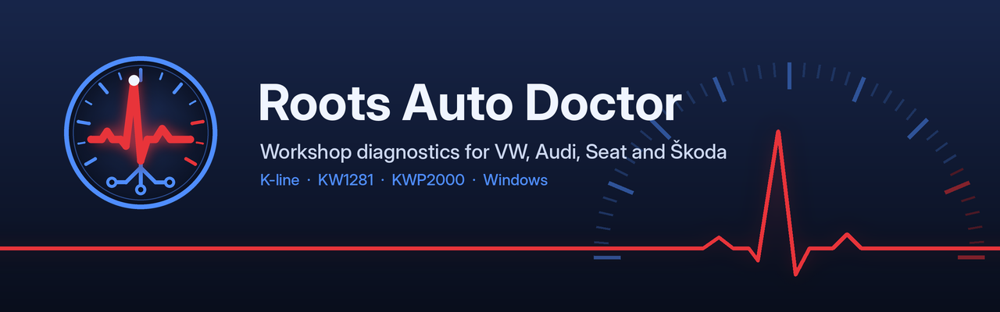

<p align="center">
  
</p>

<p align="center">
  
  
  
  
  
</p>

<p align="center">
  Diagnostic software for VAG vehicles over the K-line.<br>
  Fault codes, live data, adaptations and coding — straight from the ECU.
</p>

---

## Overview

Roots Auto Doctor communicates with VW, Audi, Seat and Škoda control modules using the
**KW1281** and **KWP2000** protocols, through an inexpensive KKL cable or a J2534 interface.
It is designed for workshops: scan the car, review the results and hand the customer a report.

## Features

- **Auto-Scan** of all common modules with a vehicle health score and one-click fault clearing
- **Fault codes** in VAG 5-digit and OBD-II format, with fault type and status
- **Live data** on gauges and charts, up to three measuring groups at once, with CSV logging
- **Guided tests** for 1.9 TDI engines: injector balance, boost pressure and mass air flow
- **Workshop functions**: basic settings, adaptation, coding, login, output tests and service reset
- **Customer reports** in PDF or web format, branded with your workshop logo
- **Diagnostic history** searchable by plate or customer
- **Cable detection and connection check** to identify drivers, latency and wiring problems
- **Built-in simulator** to use every feature without a car

## Getting started

```bat
git clone https://github.com/rNx1337k/RootsAutoDoctor.git
cd RootsAutoDoctor
run.bat
```

`run.bat` creates a virtual environment, installs the dependencies and starts the app.

1. Connect the cable to the OBD port and turn the ignition on.
2. In **Options**, click **Detect cable**, then **Connection check**.
3. Select a module or run an **Auto-Scan**.

To try the app without a car, click **Open simulator** on the home screen.

## Compatibility

**Vehicles:** VAG models up to around 2005 with a K-line diagnostic port, such as Golf IV, Bora,
Passat B5, Audi A3 8L / A4 B5–B6, Seat Leon 1M and Škoda Octavia I.

**Interfaces:**

| Interface | Support |
|---|---|
| KKL 409.1 / K-line cables (FTDI, CH340) | KW1281 and KWP2000 |
| J2534 PassThru (04.04) | KWP2000 only |
| HEX-USB clone (FTDI FT232R, VID 0403 PID FA24) | K-line only, if the cable has no microcontroller — see [docs/HEX_USB.md](docs/HEX_USB.md) |
| Genuine HEX-V2 / HEX-NET, other firmware-based interfaces | Not supported |

For FTDI cables, setting the latency timer to 1 ms in Device Manager makes live data much faster.

**Protocols:**

| Function | KW1281 | KWP2000 |
|---|:---:|:---:|
| Identification | ✓ | ✓ |
| Read and clear faults | ✓ | ✓ |
| Measuring blocks | ✓ | ✓ |
| Basic settings, adaptation, coding | ✓ | Planned |
| Login and output tests | ✓ | Planned |

## Development

| Command | Description |
|---|---|
| `run.bat` | Run the app |
| `run_tests.bat` | Run the test suite (simulator-based, no car needed) |
| `build_release.bat` | Build the compiled app and the Windows installer |

Logs and crash reports are stored in `%APPDATA%\RootsAutoDoctor\registos`.
See [CHANGELOG.md](CHANGELOG.md) for release notes.

## Status

The project is in **beta**. All features are tested against the simulator and on-vehicle testing
is in progress. To report a problem, attach the file from **Options → Support package**.

## License

Copyright © 2026. All rights reserved. This software is proprietary and may not be copied,
modified or redistributed without written permission.

<sub>VW, Audi, Seat, Škoda and VCDS are trademarks of their respective owners. Roots Auto Doctor is an
independent product and is not affiliated with Volkswagen AG or Ross-Tech LLC.</sub>
