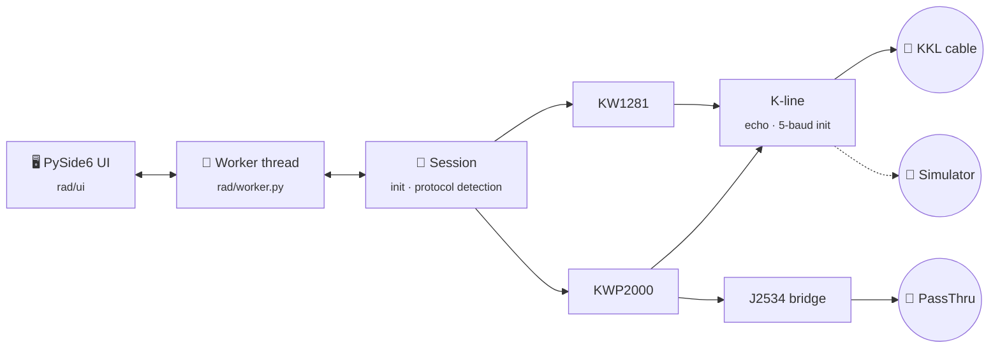

<p align="center">
  
</p>

<h1 align="center">Roots Auto Doctor</h1>

<p align="center">
  <b>Dealer-level VAG diagnostics on a €10 cable.</b><br>
  Fault codes, live data, adaptations and coding — straight from the ECU, over the K-line.
</p>

<p align="center">
  
  
  
  <br>
  
  
  
  
</p>

<p align="center">
  <a href="#-features">Features</a> •
  <a href="#-quick-start">Quick start</a> •
  <a href="#-hardware">Hardware</a> •
  <a href="#-protocol-support">Protocols</a> •
  <a href="#-under-the-hood">Under the hood</a> •
  <a href="#-roadmap">Roadmap</a>
</p>

---

## 🚗 Why Roots Auto Doctor

Older VW, Audi, Seat and Škoda models talk to diagnostic tools over the **K-line** using the
same protocols dealer tools have always used: **KW1281** and **KWP2000**.

Roots Auto Doctor speaks those protocols **natively** through an inexpensive KKL cable, wrapped in an
interface built for the workshop floor:

> **Plug in → Auto-Scan → hand the customer a branded report.** That's the whole workflow.

<table>
  <tr>
    <td align="center" width="25%"><h3>🔌</h3><b>Cheap hardware</b><br><sub>Any FTDI / CH340 KKL cable or J2534 PassThru</sub></td>
    <td align="center" width="25%"><h3>⚡</h3><b>One-click scan</b><br><sub>Every module, colour-coded, with a 0–100 health score</sub></td>
    <td align="center" width="25%"><h3>📄</h3><b>Customer-ready</b><br><sub>Branded PDF / web reports with your workshop logo</sub></td>
    <td align="center" width="25%"><h3>🧩</h3><b>No car? No problem</b><br><sub>Built-in byte-level ECU simulator</sub></td>
  </tr>
</table>

## ✨ Features

<table>
  <tr>
    <td width="50%" valign="top">
      <h4>🔍 Auto-Scan & health score</h4>
      Scans every common module, shows results as colour-coded tiles, rates the car <b>0–100</b> on an
      animated ring and clears faults across all modules in one go.
    </td>
    <td width="50%" valign="top">
      <h4>⚠️ Fault codes</h4>
      VAG 5-digit codes with their OBD-II <b>P-code</b> equivalent, fault type and
      intermittent / permanent status.
    </td>
  </tr>
  <tr>
    <td valign="top">
      <h4>📈 Live data</h4>
      Up to <b>three measuring groups</b> at once on cluster-style gauges with peak markers,
      live charts and CSV logging.
    </td>
    <td valign="top">
      <h4>🧪 Guided tests</h4>
      Injector balance, boost pressure and mass air flow checks for <b>1.9 TDI</b> engines,
      with a plain-language verdict.
    </td>
  </tr>
  <tr>
    <td valign="top">
      <h4>🛠️ Workshop functions</h4>
      Basic settings, adaptation (read / test / save), coding, login, output tests and
      service reminder reset.
    </td>
    <td valign="top">
      <h4>📄 Customer reports</h4>
      Branded PDF or web report with workshop details, vehicle data, health score,
      faults per module and technician notes.
    </td>
  </tr>
  <tr>
    <td valign="top">
      <h4>🩺 Cable & connection doctor</h4>
      <b>Detect cable</b> identifies the chip, missing drivers, HEX clones and FTDI latency.
      <b>Connection check</b> walks through echo → init → faults and tells you exactly which step failed.
    </td>
    <td valign="top">
      <h4>🗂️ History & dashboard</h4>
      Every scan and report is saved locally and searchable by plate or customer, with daily
      and monthly stats on the home screen.
    </td>
  </tr>
</table>

## 🚀 Quick start

```bat
git clone https://github.com/rNx1337k/RootsAutoDoctor.git
cd RootsAutoDoctor
run.bat
```

`run.bat` creates a virtual environment, installs the dependencies (PySide6, pyserial) and starts the app.

| Step | What to do |
|:---:|---|
| **1** | Plug the cable into the OBD port and turn the **ignition on** |
| **2** | Open **Options → Detect cable** — the COM port is picked automatically |
| **3** | Run **Connection check** to confirm the cable and car are talking |
| **4** | Pick a module (e.g. **01 Engine**) or hit **Start Auto-Scan** |

> [!TIP]
> No car nearby? On the home screen click **Open simulator** and try addresses `01`, `03` and `17`.

## 🔌 Hardware

| | Interface | Notes |
|:---:|---|---|
| ✅ | **KKL 409.1 / K-line VCDS clones** (FTDI, CH340) | Show up as a standard COM port. Full KW1281 + KWP2000 support |
| ✅ | **J2534 PassThru** (04.04) | Works with KWP2000 controllers. 32-bit drivers supported via an out-of-process bridge |
| ❌ | **HEX-USB+CAN / HEX-V2** (genuine or clone) | Closed firmware, only works with Ross-Tech software |

> [!IMPORTANT]
> KW1281 controllers can't run over J2534 — the standard can't acknowledge each byte in time. Use a KKL cable for those.

> [!TIP]
> On FTDI cables set *Device Manager → Port → Advanced → Latency Timer* to **1 ms** for much faster live data.
> **Detect cable** will tell you if it's still on the default.

## 📡 Protocol support

| Feature | KW1281 | KWP2000 (K-line) |
|---|:---:|:---:|
| Identification (part number, component) | ✅ | ✅ |
| Coding / workshop code (read) | ✅ | — |
| Read & clear fault codes | ✅ | ✅ |
| Measuring blocks | ✅ | ✅ |
| Basic settings | ✅ | 🔜 |
| Adaptation | ✅ | 🔜 |
| Coding | ✅ | 🔜 |
| Login | ✅ | 🔜 |
| Output tests | ✅ | 🔜 |

**Typical coverage:** VAG vehicles up to around 2005 with a K-line diagnostic port —
Golf IV, Bora, Passat B5, Audi A3 8L / A4 B5–B6, Seat Leon 1M, Škoda Octavia I and friends.

## ⚙️ Under the hood



<details>
<summary><b>📁 Project structure</b></summary>

```
main.py                     application entry point
rad/kline.py                serial port, echo handling, 5-baud init
rad/protocols/kw1281.py     KW1281 block protocol
rad/protocols/kwp2000.py    KWP2000 over K-line
rad/session.py              init, protocol detection and unified ECU API
rad/j2534.py                J2534 PassThru interface
rad/j2534_bridge.py         out-of-process bridge for 32-bit J2534 drivers
rad/cable.py                cable, driver and latency detection
rad/vag_data.py             modules, fault codes, fault types, measuring formulas
rad/guided.py               guided engine tests
rad/simulator.py            byte-level virtual ECUs
rad/worker.py               background communication thread
rad/report.py               customer reports
rad/history.py              local diagnostic history
rad/license.py              per-PC licence activation
rad/ui/                     PySide6 interface
tests/                      automated tests
```

</details>

<details>
<summary><b>🧪 Testing</b></summary>

```bat
run_tests.bat
```

The test suite runs entirely against the simulator and covers:

- full KW1281 and KWP2000 sessions, including automatic baud rate and echo detection;
- J2534 sessions through a simulated PassThru interface;
- fault injection: line noise, dropped bytes, cables without echo and ECUs dropping out mid-session;
- long live-data sessions and fuzzing of every decoder;
- guided test verdicts, diagnostic history and licensing.

Communication logs and crash reports are written to `%APPDATA%\RootsAutoDoctor\registos`.

</details>

<details>
<summary><b>📦 Build the installer</b></summary>

```bat
build_release.bat
```

Compiles the app to native code with Nuitka and, if [Inno Setup 6](https://jrsoftware.org/isdl.php)
is installed, produces `dist\Setup_RootsAutoDoctor_<version>.exe` with Start menu and desktop shortcuts.

</details>

<details>
<summary><b>🔑 Licensing</b></summary>

Without a licence the app runs in **evaluation mode**: every feature works and reports carry an
"evaluation version" watermark. Each licence is tied to one PC: the customer sends the PC code shown
in **Options → Licence** and receives an Ed25519-signed key.

</details>

## 🗺️ Roadmap

- [x] KW1281 full workshop function set
- [x] KWP2000 over K-line — identification, faults, measuring blocks
- [x] J2534 PassThru support
- [x] Cable detection, connection check and support package
- [x] Licence activation and compiled installer
- [ ] Basic settings, adaptation and coding over KWP2000 (EDC16)
- [ ] Measuring group labels for more petrol engines and automatic gearboxes
- [ ] CAN / UDS support for newer vehicles

## 🐞 Status & bug reports

Roots Auto Doctor is in **beta**. All features are validated against the built-in simulator;
on-vehicle testing is in progress.

Found a problem? Open **Options → Support package** — it bundles the recent communication logs,
crash log and detected cables into a zip (no licences or customer data). Attach it to your bug report. 🙏

See [CHANGELOG.md](CHANGELOG.md) for what's new in each release.

## 📜 License

Copyright © 2026. All rights reserved. This software is proprietary and may not be copied,
modified or redistributed without written permission.

<sub>VW, Audi, Seat, Škoda and VCDS are trademarks of their respective owners. Roots Auto Doctor is an
independent product and is not affiliated with or endorsed by Volkswagen AG or Ross-Tech LLC.</sub>
