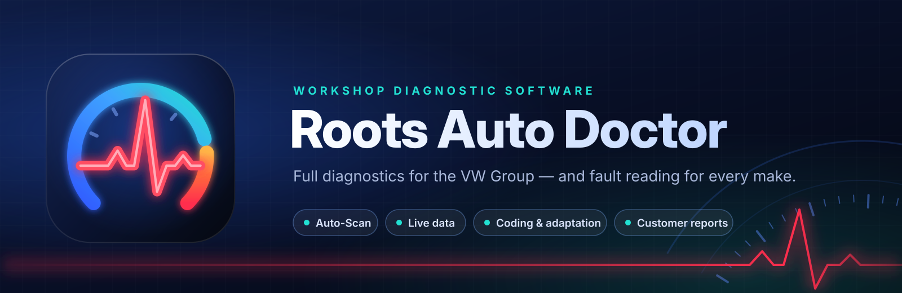
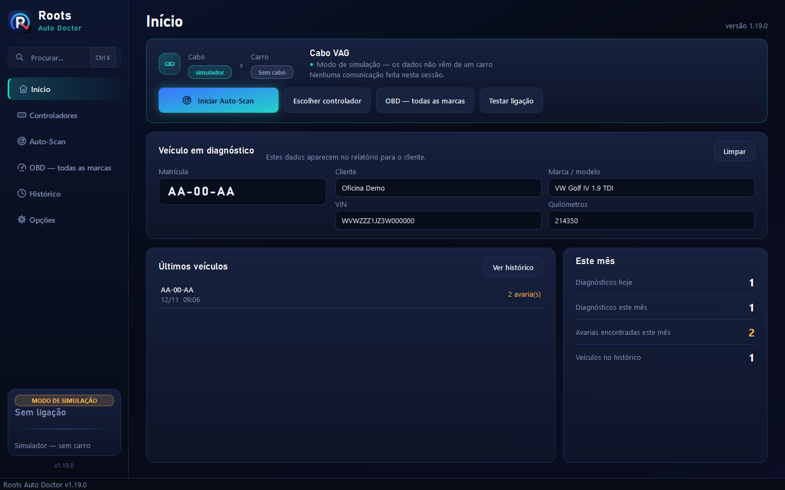
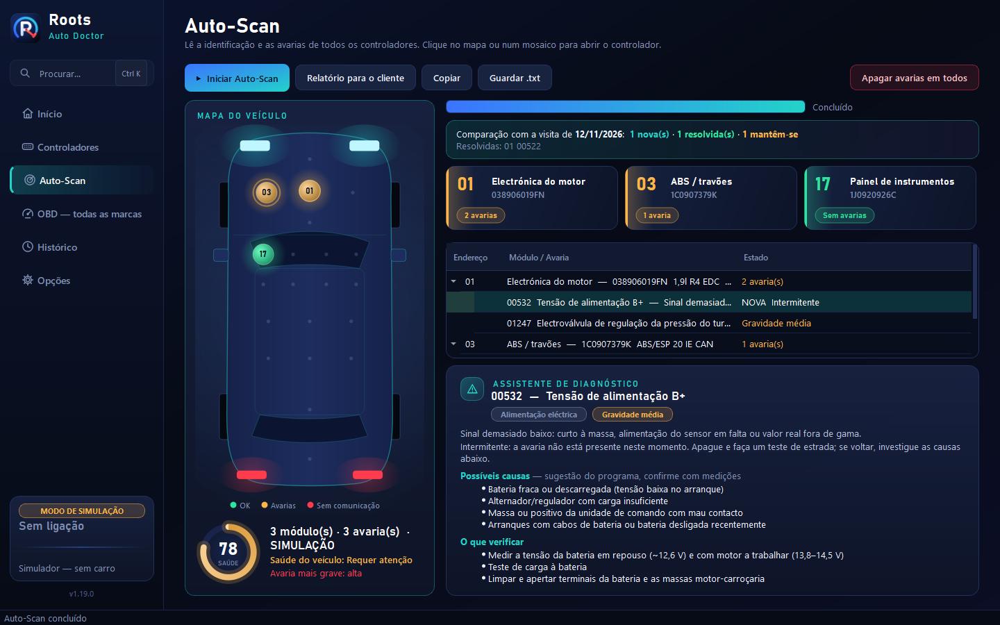
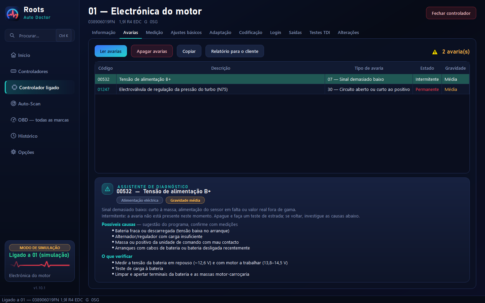
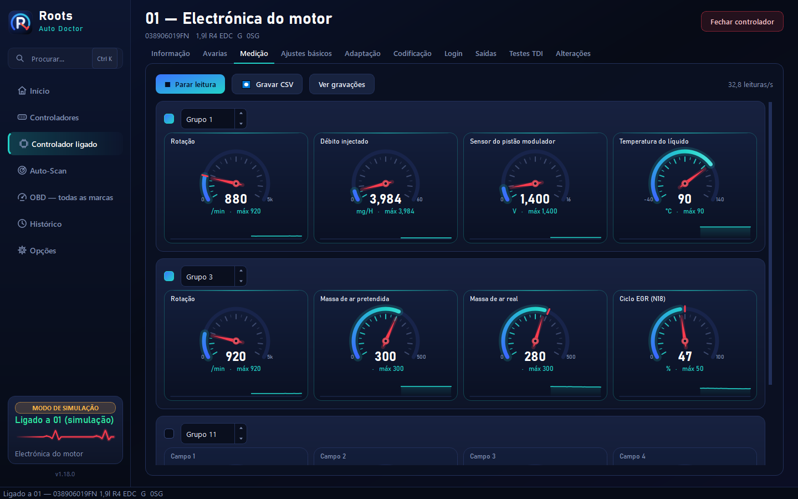
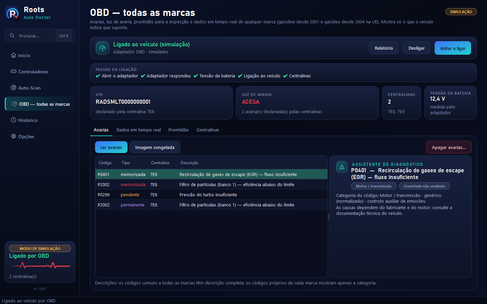

  

  <a href="README.md">English</a> · <b>Português</b>

  
  
  
  

  <b>Software de diagnóstico para oficinas.</b> 
  Diagnóstico completo para o Grupo VW e leitura de avarias em qualquer marca — numa só aplicação.

  

---

## O que faz

### 🔍 Diagnóstico
- **Auto-Scan com mapa do veículo** — lê todos os controladores e mostra no carro onde estão as avarias, com uma
  pontuação de saúde do veículo e apagar avarias num clique
- **Assistente de diagnóstico** — gravidade, causas prováveis e o que verificar em cada avaria
- **Comparação de visitas** — avarias novas, resolvidas e repetidas desde a última visita do carro
- **Valores em tempo real** em mostradores e gráficos, com gravação para folha de cálculo
- **Testes guiados** para motores 1.9 TDI: equilíbrio dos injectores, pressão do turbo e massa de ar
- **Qualquer marca** — avarias, luz de avaria, prontidão para a inspecção e valores em tempo real com um adaptador
  OBD normal

### 🔧 Funções de oficina
- **Ajustes básicos, adaptação, codificação, login, teste de saídas e reposição do indicador de revisão**
- **Histórico de alterações** — cada codificação e adaptação fica guardada com o valor anterior, para repor o
  original em dois cliques
- **Nada é dado como feito sem o controlador o confirmar** — cada valor gravado é lido de volta

### 📄 Clientes e relatórios
- **Relatórios em duas versões** — uma simples para o cliente e uma técnica para a oficina, com o seu logótipo, as
  avarias encontradas, as causas prováveis e o trabalho feito; pré-visualizar, guardar em PDF ou imprimir
- **Veículos e clientes** — cada carro é registado uma vez; escreva a matrícula ou leia o VIN e os dados do cliente
  aparecem sozinhos
- **Histórico de diagnósticos** pesquisável por matrícula, VIN ou cliente

### 💻 O programa
- **Simulador incluído** para experimentar todas as funções sem carro
- **Modo de ecrã grande** para ler o ecrã de dentro do carro
- **Português e inglês**
- **Funciona sem internet**, com **actualizações automáticas** quando há ligação

## Capturas de ecrã

  

| Auto-Scan com mapa do veículo | Avarias com assistente de diagnóstico |
|---|---|
|  |  |
| **Valores em tempo real** | **Qualquer marca (OBD)** |
|  |  |

Ecrãs tirados com o simulador incluído.

## Veículos

| | |
|---|---|
| **VW, Audi, Seat, Škoda até ~2005** | Diagnóstico completo, incluindo codificação e adaptação — ex.: Golf IV, Bora, Passat B5, Audi A3 8L, A4 B5/B6, Seat Leon 1M, Škoda Octavia I |
| **VW, Audi, Seat, Škoda a partir de ~2004** *(beta)* | Identificação, avarias e valores de medição de todos os controladores, Auto-Scan — ex.: Golf V/VI, Audi A3 8P, Passat B6, Octavia II |
| **Qualquer marca** | Avarias, luz de avaria, prontidão e valores em tempo real nos carros com diagnóstico OBD (gasolina desde 2001, gasóleo desde 2004 na UE) |

## Cabos e interfaces

| Equipamento | Para | Estado |
|---|---|---|
| **Cabo de diagnóstico VAG (KKL)**, USB | Grupo VW até ~2005 | ✅ Pronto · 🚗 validação no carro em curso |
| **Adaptador OBD** (USB ou Bluetooth; recomendado OBDLink) | Qualquer marca · Grupo VW desde ~2004 | ✅ Pronto · 🚗 validação no carro por fazer |
| **Interface de diagnóstico profissional** (J2534 PassThru) | Grupo VW · qualquer marca | ✅ Pronto · 🚗 validação no carro por fazer |
| Interfaces fechadas de outros sistemas de diagnóstico | — | ⛔ Não suportadas — o programa reconhece-as e explica porquê |

"Pronto" quer dizer que todas as funções trabalham e estão testadas com o simulador incluído; a leitura de avarias
foi também conferida com dados reais capturados num carro. O estado completo, protocolo a protocolo, está em
[docs/COBERTURA.md](docs/COBERTURA.md).

## O que precisa

- Um PC com **Windows 10 ou Windows 11 (64 bits)**
- Um dos cabos ou interfaces acima

**Não é preciso instalar mais nada.** O Roots Auto Doctor traz tudo o que precisa.

## Descarregar

Na página [Releases](https://github.com/rNx1337k/RootsAutoDoctor/releases):

- **`Setup_RootsAutoDoctor_<versão>.exe`** — instala o programa com atalhos no menu Iniciar e no ambiente de
  trabalho (recomendado)
- **`RootsAutoDoctor_<versão>_portatil.zip`** — versão portátil: extraia para qualquer pasta (até uma pen USB) e
  abra o `RootsAutoDoctor.exe`

> [!NOTE]
> Da primeira vez, o Windows pode mostrar *"O Windows protegeu o seu PC"*: clique em **Mais informações → Executar
> mesmo assim**.

## Primeiros passos

1. Ligue o cabo ao PC e abra o Roots Auto Doctor.
2. Vá a **Opções → Detectar cabo** — o programa encontra o cabo sozinho.
3. Ligue o cabo ao carro, ligue a ignição e clique em **Testar ligação**.
4. Faça um **Auto-Scan**, ou escolha um controlador.

Sem carro por perto? Clique em **Abrir simulador** no ecrã inicial.

## Licença

Cada licença é para um PC da oficina e é activada **sem internet**: envie ao seu fornecedor o ID do PC que aparece
em **Opções → Licença** e cole a chave que receber. Sem licença o programa funciona em modo de demonstração — lê
tudo, mas não altera nada num carro real.

## Suporte

Alguma coisa não funciona num carro? Vá a **Opções → Gravar comunicação**, repita o que falhou, pare a gravação e
envie o **Pacote de suporte** ao seu fornecedor. Leva os registos do programa e as últimas gravações — sem dados
dos clientes.

Os diagnósticos, as definições, a licença e o logótipo da oficina ficam no PC e não são apagados quando o programa
é desinstalado ou actualizado.

## Actualizações

O Roots Auto Doctor mantém-se sempre actualizado, instalado ou portátil, sem clicar em nada: procura uma versão
nova quando abre e de poucas em poucas horas, e descarrega-a em segundo plano. Se ainda não começou a trabalhar,
fecha, actualiza e volta a abrir sozinho; senão, instala quando fechar o programa (ou logo, com **Actualizar para a
versão …**). Só são instaladas versões assinadas pelo editor. Se uma actualização não terminar, o programa continua
a funcionar na versão anterior e avisa.

## Estado

O Roots Auto Doctor está em **beta**. Todas as funções podem ser experimentadas com o simulador incluído, e a
validação nos veículos está em curso. Os resultados simulados estão sempre identificados como tal, no ecrã e nos
relatórios.

---

Copyright © 2026. Todos os direitos reservados. Este software é proprietário e não pode ser copiado, modificado
nem redistribuído sem autorização escrita. VW, Audi, Seat e Škoda são marcas dos respectivos donos; o Roots Auto
Doctor é um produto independente e não está associado à Volkswagen AG.
Documentação para programadores: [docs/DEVELOPMENT.md](docs/DEVELOPMENT.md) (em inglês).
